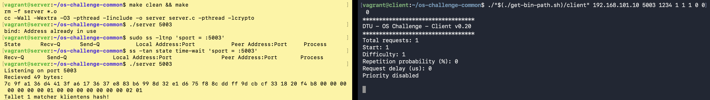

# os-challenge-skavira

TCP server for the OS Challenge in course 02159: the client sends a SHA-256 hash and a search interval, and the server finds and returns the correct number.

## Structure

- `server.c`: The submitted server - a **thread pool with a cache for repeated requests**: `main()` starts one worker thread per CPU, then accepts connections, reads each request and looks its hash up in the cache (`cache_c_lookup_or_wait()`). A hit is answered at once, a repeat of a request that is still being computed waits for it, and every other request goes into a FIFO queue. Each worker takes a request, brute-forces it in `handle_client_c()` and answers it together with any repeats waiting for it. The thread pool comes from the concurrency experiment and the cache from the cache experiment (variant C), see [Experiments](#experiments).
- `include/server_helpers.h`: `struct request` (the decoded 49-byte request) and declarations of the shared helper functions.
- `src/server_helpers.c`: The shared helpers used by the server and every experiment variant: `parse_port_or_exit`, `ignore_sigpipe`, `create_listening_socket`, `accept_client`, `read_request`, `find_answer` (brute force with lonesha256), `send_answer` and `handle_client` (one complete request: read → search → reply → close).
- `include/cache_c.h`, `src/cache_c.c`: The cache used by `server.c`: an array of entries (hash, answer, done flag, and a waiting list of up to 16 client fds), protected by one mutex. Copied from `experiments/cache/` (variant C).
- `include/messages.h`: Packet sizes and offsets for byte mapping.
- `include/lonesha256.h`: SHA-256 function; the implementation is included in `src/server_helpers.c`.
- `Makefile`: `make` builds `server` (what the graders run). `make experiments` builds the experiment variants into `bin/` - see [Experiments](#experiments).
- `experiments/`: One folder per experiment (variants, results), plus the shared `run-experiment.sh` and `summarize.py`.
- `bin/`: Experiment binaries built by `make experiments` (not committed).

## Packet Mapping

A request is **49 bytes**. Use `PACKET_REQUEST_*` from `messages.h`:

| Bytes | Content | Offset Constant |
| --- | --- | --- |
| 0–31 | SHA-256 hash | `PACKET_REQUEST_HASH_OFFSET` |
| 32–39 | Search interval start (64-bit) | `PACKET_REQUEST_START_OFFSET` |
| 40–47 | Search interval end (64-bit) | `PACKET_REQUEST_END_OFFSET` |
| 48 | Priority | `PACKET_REQUEST_PRIO_OFFSET` |

The client sends the interval boundaries in big-endian. The expected response is **8 bytes** containing the found number (`PACKET_RESPONSE_SIZE`, offset `PACKET_RESPONSE_ANSWER_OFFSET`).


## Run Locally

Requires a C compiler and `make`.
Run the commands from the project root.

**Terminal 1 – Build and start the server:**

```sh
make clean && make
./server 8080
```

**Terminal 2 – Send a simple request:**
```sh
client_bin=arm64/bin/macos/client
# Linux ARM64: client_bin=arm64/bin/linux/client
# Linux x86_64: client_bin=x86_64/bin/linux/client
chmod +x "$client_bin"
"./$client_bin" 127.0.0.1 8080 0 1 1 1 0 0 0
```
The client arguments are `host port seed total start difficulty rep delay lambda`.
The client prints one line per answer and finally `Results: <reliability %> <score>`; the server only prints its start-up line. To see every received request, build with `make clean && make DEBUG=1`.
After code changes: stop the server with `Ctrl+C`, run `make clean && make`, and start it again.
No native macOS client for Intel is provided; use the VM flow there instead.

# Mac

Requires Vagrant and the VMware Desktop provider for `arm64/` or VirtualBox for `x86_64/`.
Run `vagrant up` from the relevant directory and open two terminals using `vagrant ssh server` and `vagrant ssh client` respectively from the same directory.

The project root is shared as `/home/vagrant/os-challenge-common/` in both VMs.

If both VM terminals are already open, use the following commands.

**Server terminal (`vagrant ssh server`) – start this first:**

```sh
cd /home/vagrant/os-challenge-common
make clean && make
./server 5003
```

**Client terminal (`vagrant ssh client`):**

```sh
cd /home/vagrant/os-challenge-common
chmod +x "$(./get-bin-path.sh)/client"
./run-client.sh
```



Keep the server running while the client sends requests. Run `./run-client.sh` again to repeat the test.
The script uses server IP `192.168.101.10` and port `5003`; the client VM has IP `192.168.101.11`.

After code changes on the host, stop the server with `Ctrl+C`, run `make clean && make` in the server VM, and start it again with `./server 5003`.

## Stopping the client, server, and VMs

1. Let the client finish its requests and return to the prompt. To interrupt a running or stuck client, press `Ctrl+C` in the client terminal.
2. Once the client has finished, press `Ctrl+C` in the server terminal. The server does not currently have a graceful shutdown handler, so let requests finish before stopping it.
3. Run `exit` in both terminals to leave the SSH sessions. This disconnects the terminals but leaves the VMs running.
4. To shut down both VMs cleanly, run the following on your Mac from the same `arm64/` or `x86_64/` directory where you ran `vagrant up`:

   ```sh
   vagrant halt
   ```

Use `vagrant up` from that directory to start the VMs again, then reconnect with `vagrant ssh server` and `vagrant ssh client` and run the startup commands above.

# Windows (Vagrant + VirtualBox)

On Windows, don't build natively (PowerShell/MSYS2/MinGW). The server uses POSIX sockets, which MinGW doesn't have, and it gets graded on Linux. Use the two Vagrant VMs instead. They copy the grading setup.

## The mental model

There are three layers. Each command runs in exactly one of them:

```
 WINDOWS HOST  (PowerShell, in C:\DTU-local\Repos\os-challenge-skavira\x86_64)
 │   You edit code here (VS Code etc.) and run the vagrant commands here.
 │   vagrant up / halt / destroy / ssh  ── controls VirtualBox
 │
 ├── VM "server"  192.168.101.10   (Ubuntu 24.04, 4 CPUs, 512 MB)
 │     /home/vagrant/os-challenge-common/   ← THIS REPO, live-shared from Windows
 │     make clean && make
 │     ./server 5003                        ← your server listens here
 │
 └── VM "client"  192.168.101.11   (Ubuntu 24.04, 2 CPUs, 512 MB)
       /home/vagrant/os-challenge-common/   ← the same shared folder
       ./run-client.sh                      ← sends requests to 192.168.101.10:5003
```

Key points:

- **The repo root is the shared folder.** The `Vagrantfile` in `x86_64/` mounts `../` (the repo root) at `/home/vagrant/os-challenge-common/` in both VMs. The folder name says "common", but it contains *this* repo. You don't need to clone or copy anything into the VMs: save a file in Windows and the VMs see the change immediately.
- **Vagrant ties VMs to the folder you run it in.** It records which VMs belong to a Vagrantfile in the `.vagrant/` folder next to it. So always run `vagrant` commands from `os-challenge-skavira\x86_64`. Running them from another folder (e.g. a separate `os-challenge-common` clone) talks to a different set of VMs, or says "VM not created".
- **The two VMs talk over a private network.** That network exists only between the VMs and your PC. The client scripts have `192.168.101.10:5003` hardcoded, so the server must run on port **5003** in the server VM.
- **Compile inside the VM, not on Windows.** The `server` binary is a Linux program.

## One-time setup

1. Install **VirtualBox** and **Vagrant ≥ 2.4** (older Vagrant versions can't read the bento box metadata and fail with "doesn't support the provider").
2. If Hyper-V / WSL2 / "Virtual Machine Platform" is enabled, VirtualBox may be very slow or refuse to start VMs. Hardware virtualization (VT-x/AMD-V) must be enabled in the BIOS.
3. Download the box and create the VMs (the first `vagrant up` takes several minutes because it runs `bootstrap.sh`: apt upgrade, git, build-essential):

```powershell
cd C:\DTU-local\Repos\os-challenge-skavira\x86_64
vagrant box add bento/ubuntu-24.04 --provider virtualbox --architecture amd64
vagrant up
```

`x86_64/Vagrantfile` sets `box_architecture = "amd64"` for both VMs. Without it, Vagrant on Windows fails to match the downloaded box and `vagrant up` tries (and fails) to download it again.

## Everyday workflow

Open **two PowerShell windows**, both in `C:\DTU-local\Repos\os-challenge-skavira\x86_64`.

```powershell
vagrant up              # start both VMs (fast after the first time; no-op if already running)
```

**Window 1 – server VM (start this first):**

```powershell
vagrant ssh server
```
```sh
cd ~/os-challenge-common
make clean && make
./server 5003
```

**Window 2 – client VM:**

```powershell
vagrant ssh client
```
```sh
cd ~/os-challenge-common
chmod +x "$(./get-bin-path.sh)/client"
./run-client.sh                 # small sanity test (20 requests)
```

**Edit–test loop:** edit code in Windows → in window 1 press `Ctrl+C`, run `make clean && make && ./server 5003` → in window 2 run `./run-client.sh` again.

**Commit and push from Windows** as usual. The VMs only build and run the code.

## Test scripts (run in the client VM)

| Script | What it does |
| --- | --- |
| `./run-client.sh` | Small quick test: 20 requests, low difficulty. Use for "does it work at all". |
| `./run-client-milestone.sh` | Exact milestone configuration: 100 requests, difficulty 30M, 20 % repeats, priorities. |
| `./run-client-final.sh` | Final-run configuration: 500 requests (the real seed is secret). |

**Reference server:** to check that the VM setup works, or to get a baseline score, run the course's reference server in the server VM instead of ours, then run a client script as normal:

```sh
cd ~/os-challenge-common
chmod +x "$(./get-bin-path.sh)/server"
./run-reference-server.sh       # listens on 5003, same as ours
```

The client prints its results when it finishes.

## Vagrant command cheat sheet (PowerShell, in `x86_64\`)

| Command | Effect |
| --- | --- |
| `vagrant status` | Shows the state of `server` and `client` (running / poweroff / not created). |
| `vagrant up` | Creates the VMs if missing (and provisions them), otherwise boots them. |
| `vagrant ssh server` / `vagrant ssh client` | Opens a shell in that VM. `exit` leaves it; the VM keeps running. |
| `vagrant halt` | Shuts both VMs down cleanly. Everything is kept. |
| `vagrant reload` | Restarts the VMs and applies `Vagrantfile` changes. |
| `vagrant provision` | Re-runs `bootstrap.sh` on running VMs. |
| `vagrant destroy -f` | Deletes the VMs completely. The next `vagrant up` builds them from scratch. Your code is safe (it lives on Windows). |

Add a machine name to target only one, e.g. `vagrant halt client`.

Shutting down: stop the client, then `Ctrl+C` the server, `exit` both shells, and `vagrant halt`.

## Troubleshooting

| Symptom | Cause / fix |
| --- | --- |
| `VM must be created before running this command` / `VM not created`, but VirtualBox shows `server` and `client` running | Those VMs were created from **another folder** (e.g. a separate `os-challenge-common\x86_64`), so this folder's `.vagrant\` doesn't know them. Go to that folder and run `vagrant destroy -f` (or delete the VMs in VirtualBox Manager), then run `vagrant up` here. |
| `Could not rename the directory ... VirtualBox VMs\server ... (VERR_ALREADY_EXISTS)` | A VM or folder named `server`/`client` already exists (the Vagrantfile renames the VMs to those names). Run `vagrant destroy -f` here, remove the old VM in VirtualBox Manager (or delete the orphan folder in `C:\Users\<you>\VirtualBox VMs\`), then `vagrant up`. |
| `The box you're attempting to add doesn't support the provider` | Vagrant older than 2.4, or a missing `--architecture amd64` / `box_architecture`. See setup. |
| `/bin/sh^M: bad interpreter` or `$'\r': command not found` when running a script in a VM | Git on Windows checked the scripts out with CRLF line endings. Run `git config core.autocrlf input` in the repo and re-checkout, or run `sed -i 's/\r$//' *.sh` inside the VM. |
| Client: `Connection refused` | The server isn't running in the server VM, or it's on a port other than 5003. |
| `Permission denied` running the client/reference server | Run the `chmod +x "$(./get-bin-path.sh)/client"` (or `/server`) line. |
| `vagrant up` hangs at "Waiting for machine to boot" | Usually a Hyper-V conflict or virtualization disabled in the BIOS. |

# Experiments

Every group member conducts at least one experiment that compares solutions under identical conditions. This section describes how experiments are organised, built, run and recorded. The analysis and discussion of each experiment is in the report.

## Folder structure

```
experiments/
├── run-experiment.sh            runs the client once and saves the output (client VM)
├── summarize.py                 collects results into runs.csv and summary.csv
└── <experiment>/
    ├── server_<variant>.c       one main() per variant -> bin/<experiment>/server-<variant>
    ├── *.c, *.h                 optional extra sources/headers, linked into every variant
    ├── config.mk                optional build flags (see below)
    └── results/
        ├── <variant>_t<total>_d<delay>_s<seed>_r<run>.txt   raw client output, one file per run
        ├── notes.md             pilot measurements and observations
        ├── runs.csv             one row per run        (generated by summarize.py)
        └── summary.csv          median/min/max per variant and setting (generated)
```

Within an experiment only the part under test differs. The concurrency variants all call the same `handle_client()` from `src/server_helpers.c`. The cache variants each have their own `handle_client_<variant>()`, because where the cache lookup happens is what the cache experiment tests.

## Baselines, branches and tags

Experiments build on each other: once an experiment's winner is adopted into `server.c`, later experiments compare against that version.

| Tag | Commit content | Used as |
| --- | --- | --- |
| `baseline-refactor` | Sequential server at the milestone (milestone test: 100 %, score 296 695 793) | B0: reference for the concurrency experiment |
| `exp-concurrency-measured` | Shared helpers + the three concurrency variants, exactly as measured | Reproduces every result in `experiments/concurrency/results/` |
| `baseline-v1` | Thread pool adopted into `server.c` | B1: reference for the cache experiment |
| `exp-cache-measured` | The three cache variants and `baseline-v1`'s `server.c`, exactly as measured | Reproduces every result in `experiments/cache/results/` |
| `baseline-v2` | Thread pool + cache (variant C) adopted into `server.c` (milestone test: 100 %, score 49 891 887) | B2: reference for the priority experiment |
| `exp-priority-measured` | Cached FIFO baseline and both priority variants at `842264d`, exactly as measured | Reproduces the baseline-v2 priority comparison |

## Building

Run in the server VM, from `~/os-challenge-common`:

| Command | Result |
| --- | --- |
| `make` | `./server` - the submitted server |
| `make baseline` | `bin/server-baseline` - the current root `server.c`, without experiment flags |
| `make experiments EXP=concurrency` | `bin/server-baseline` + all variants of one experiment |
| `make experiments` | Baseline + all experiments |
| `make list` | Lists the experiments, their binaries and flags |
| `make new-experiment EXP=<name>` | Creates `experiments/<name>/` with a first variant copied from `server.c` |
| `make DEBUG=1 ...` | Prints every request - for debugging only, never for measurements |
| `make clean` | Removes `./server` and `bin/` |

`bin/server-baseline` is always built from the root `server.c`, so it follows the current baseline. To reproduce an older experiment, check out its tag first (`git checkout exp-concurrency-measured`).

Optional per-experiment build flags go in `experiments/<name>/config.mk`:

```make
CFLAGS_cache = -DUSE_CACHE              # all variants in experiments/cache/
CFLAGS_cache_pool_cache = -DUSE_CACHE   # only experiments/cache/server_pool_cache.c
```

Each variant is compiled together with `src/server_helpers.c`, so these flags also reach `#ifdef` blocks in the shared code. A variant can reuse another experiment's code with a one-line file, for example `experiments/cache/server_pool_cache.c` containing `#include "../concurrency/server_pool.c"`.

## Running an experiment

**Server VM** - start the variant to measure:

```sh
./bin/concurrency/server-pool 5003        # or ./bin/server-baseline 5003, ...
```

**Client VM** - run the client against it and save the result:

```sh
EXP=concurrency VARIANT=pool SEED=1 RUN=1 ./experiments/run-experiment.sh
```

`EXP` and `VARIANT` are required. Every other setting defaults to `run-client-final.sh`:

| Variable | Default | Meaning |
| --- | --- | --- |
| `SEED` | 5041 | Fixes the request sequence: same seed = identical requests |
| `TOTAL` | 500 | Number of requests |
| `DIFFICULTY` | 30000000 | Size of each search interval |
| `REP_PROB_PERCENT` | 20 | Probability that a request repeats an earlier one |
| `DELAY_US` | 600000 | Mean delay between requests (lower = higher load) |
| `PRIO_LAMBDA` | 1.5 | Priority distribution (0 = all priority 1) |
| `RUN` | 1 | Repetition number for the same seed |
| `START`, `SERVER`, `PORT` | 0, 192.168.101.10, 5003 | As in the course scripts |

The script refuses to overwrite an existing result file and warns if the run did not finish.

**Rules for every measurement:**

1. Every run must report `Results: 100.00`. A run below 100 % is kept and investigated, not deleted.
2. Compare variants on the same seeds and settings, and on the same machine - absolute scores depend on the host.
3. Restart the server after an interrupted run. Servers that keep state between requests (e.g. a cache) must be restarted before every run.
4. Commit the result files after each session (`git add experiments/<name>/results`).

## Summarising results

```sh
python3 experiments/summarize.py concurrency
```

This writes `experiments/concurrency/results/runs.csv` (every run) and `summary.csv` (per variant, `TOTAL` and delay: number of runs, lowest reliability, median/min/max score). `summary.csv` can be read directly by the report's figures.

## Experiment overview

### Concurrency model (#7) - Jeppe Vind (s245326)

**Question:** Which concurrency model gives the lowest score: one thread per request, one process per request, or a fixed thread pool?

| Variant | Source | Mechanism |
| --- | --- | --- |
| `baseline` | `server.c` at `exp-concurrency-measured` | Sequential: one request at a time |
| `thread` | `experiments/concurrency/server_thread.c` | One detached `pthread` per request |
| `fork` | `experiments/concurrency/server_fork.c` | One child process per request (`fork`) |
| `pool` | `experiments/concurrency/server_pool.c` | N = #CPUs worker threads + FIFO queue (mutex + condition variables) |

**Setup:** Final client configuration, seeds 1-3, one run per seed, measured at commit `97c2c84` (tag `exp-concurrency-measured`). Run-to-run variation was checked by repeating seed 1 for the concurrent variants. A load sweep (`TOTAL=100`, seed 2, delays 2000/1000/600/300/100 ms) compares `thread` and `pool`. Pilot: a single request takes on average 4.83 s on the 4-CPU server VM.

**Result (final configuration, median of seeds 1-3, all runs 100 % reliable):**

| Variant | Median score | vs baseline |
| --- | --- | --- |
| baseline | 1 487 568 066 | - |
| fork | 338 285 785 | -77.3 % |
| thread | 326 136 907 | -78.1 % |
| **pool** | **229 110 685** | **-84.6 %** |

Run-to-run variation was about 2 %, so `thread` and `fork` cannot be told apart. The pool is about 30 % better than `thread` at every overloaded setting, while at 2000 ms (spare capacity) `thread` and `pool` score the same.

**Conclusion:** The thread pool is adopted as the server (`server.c`). It also provides the shared memory a cache needs and the queue that priority scheduling needs.

### Cache for repeated requests (#6) - Nikolai Kurt Skarum (s245999)

**Question:** Does a cache for repeated requests lower the score, and does it matter where the server looks a request up: in the worker, in both the dispatcher and the worker, or in the dispatcher with repeats waiting for an original that is not finished yet?

| Variant | Source | Mechanism |
| --- | --- | --- |
| `baseline` | `server.c` at `exp-cache-measured` (= `baseline-v1`) | Thread pool, no cache |
| `a` | `experiments/cache/server_a.c` + `cache.c` | The worker looks the hash up before the brute force and stores the answer after it |
| `b` | `experiments/cache/server_b.c` + `cache.c` | The dispatcher looks the hash up before queueing (a hit is answered at once); the worker looks it up again before the brute force |
| `c` | `experiments/cache/server_c.c` + `cache_c.c` | The dispatcher looks the hash up and stores new hashes as unfinished. A repeat of an unfinished hash waits on that entry (up to 16 per entry) and is answered when the original is done, so no hash is brute-forced twice |

All caches are an array of 2048 entries, searched linearly and protected by one mutex that is never held during a brute force. Nothing is evicted, since a run has at most 500 requests.

**Setup:** Final client configuration, seeds 1-3 plus seed 1 once more (4 runs per variant), measured at commit `e18fdd1` (tag `exp-cache-measured`). For each seed the variants ran in turn (baseline, A, B, C), and the server was restarted before every run so the cache started empty. Measured on a different machine than the concurrency experiment: a single request takes about 6.6-7.0 s here (pilot: 10 requests, 15 s apart) against 4.83 s there, so the scores of the two experiments cannot be compared.

**Result (final configuration, median of 4 runs, all runs 100 % reliable):**

| Variant | Median score | vs baseline |
| --- | --- | --- |
| baseline | 432 646 683 | - |
| a | 313 947 749 | -27.4 % |
| b | 283 704 907 | -34.4 % |
| **c** | **261 361 198** | **-39.6 %** |

The order was the same in all four runs: C before B before A before baseline. Within each run, C was 5-8 % better than B, and B 9-11 % better than A. The second seed-1 run was 4-12 % slower than the first, probably because the machine drifted during the night, but running the variants in turn kept that from changing the order.

The server logs (`experiments/cache/results/server_logs/`) show where C's lead comes from. In the first seed-1 run, A and B answered 97 repeats from the cache and brute-forced 403 requests. C answered 36 repeats at once, let 62 wait for their original, and brute-forced 402. So C saves only one or two brute forces per run; its lead over B comes from repeats that no longer wait in the queue. The waiting list was never full in any run.

**Conclusion:** Variant C is adopted as the server (`server.c` with `src/cache_c.c` and `include/cache_c.h`, tag `baseline-v2`).

### Priority scheduling (#8) - Frederik Holm

**Question:** Does serving high-priority requests first improve the cached thread pool, and does interrupting low-priority work between search chunks improve it further?

| Variant | Source | Mechanism |
| --- | --- | --- |
| `baseline_v2` | `server.c` at `baseline-v2` | Thread pool + cache C + FIFO queue |
| `priorityQueue_cache_v2` | `experiments/priority/server_priorityQueue.c` | Same cache + highest-priority-first queue; FIFO within each priority |
| `priorityChunked_cache_v2` | `experiments/priority/server_priorityChunked.c` | Same cache + priority queue + cooperative preemption after each 100,000 guesses |

**Setup:** Final client configuration, seeds 1-3, one run per seed and variant, on the same ARM64 server VM with 2 online CPUs and 2 workers. All servers start with an empty cache. The variant order rotates between seeds. Measured server sources are at `842264d` (tag `exp-priority-measured`); frozen build inputs and binary hashes are also saved with the batch.

**Result (median of three seeds, all 4,500 answers correct, lower score is better):**

| Variant | Median score | vs baseline | Median wall time |
| --- | --- | --- | --- |
| baseline_v2 | 256 787 689 | - | 755.36 s |
| **priorityQueue_cache_v2** | **213 473 810** | **-16.9 %** | 758.96 s |
| priorityChunked_cache_v2 | 215 460 837 | -16.1 % | 754.97 s |

Both priority policies improve the score on every seed. The simple priority queue wins seeds 1 and 2; chunking wins seed 3. Their paired differences are below 1%, and identical-seed repetitions were not performed in this batch, so these measurements do not establish a meaningful performance difference between them. The simple queue has the lowest median and is the simpler implementation. Whole-test duration is similar: priority changes who waits, while all three servers solve the same unique hashes.

Results and per-seed comparisons: [`batch-20261109-182216Z`](experiments/priority/results/batch-20261109-182216Z/). Detailed setup, limitations and follow-up hypotheses: [`experiments/priority/README.md`](experiments/priority/README.md). The older measurements without a cache remain a separate baseline-v1 experiment.
